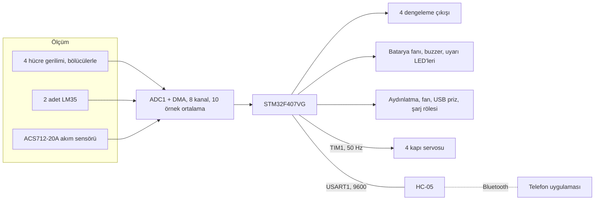

# STM32F407 ile 4S batarya yönetimi ve Bluetooth kontrollü ev otomasyonu

4 seri Li-ion batarya paketini izleyen, hücreleri dengeleyen, sıcaklığa göre fan ve alarmı yöneten ve bütün bunları Bluetooth üzerinden telefona bildiren yazılım. Aynı kart bataryadan beslenen küçük bir ev sisteminin çıkışlarını da (aydınlatma, fan, USB priz, kapı servoları) telefondan gelen komutlarla açıp kapatıyor.

## Blok diyagram



## Yazılımın yaptıkları

- Dört hücrenin gerilimini ayrı ayrı ölçer, paket gerilimini ve şarj yüzdesini hesaplar.
- Akımı ölçer, anlık gücü ve harcanan toplam enerjiyi (Wh) tutar, kalan süreyi tahmin eder.
- Ortalamanın üzerinde kalan hücreyi pasif olarak dengeler.
- Batarya 35 C'yi geçince fanı, 55 C'yi geçince buzzer ve uyarı LED'lerini çalıştırır.
- Yarım saniyede bir bütün değerleri telefona gönderir.
- Telefondan gelen komutlarla röleleri ve servoları sürer.

## Dosyalar

| Dosya | İçerik |
|---|---|
| `adc_read.c` | ADC okuma, filtre, gerilim, sıcaklık, akım, şarj yüzdesi ve enerji hesabı |
| `balance.c` | pasif hücre dengeleme |
| `protection.c` | sıcaklığa bağlı fan ve alarm |
| `bluetooth.c` | telemetri gönderme ve komut alma |
| `main.c` | çıkış tabloları, başlatma ve ana döngü |

## Pinler

| Pin | Görev |
|---|---|
| PA2, PA3, PA4, PA5 | hücre düğüm gerilimleri 1 ile 4 (gerilim bölücü üzerinden) |
| PA6, PA7 | LM35 sıcaklık sensörleri |
| PC0 | ACS712 akım sensörü çıkışı |
| PB9, PB8, PB7, PB6 | dengeleme çıkışları, hücre 1 ile 4 |
| PB0 | şarj rölesi |
| PD12, PD11 | aydınlatma 1 ve 2 |
| PD10, PD8 | fan 1 ve 2 |
| PD9 | USB priz, 5 V |
| PD14 | batarya fanı |
| PD15 | buzzer |
| PD5, PD6 | uyarı LED'leri |
| PE9, PE11, PE13, PE14 | servo 1 ile 4, TIM1 CH1 ile CH4 |
| PA9, PA10 | USART1, HC-05 |

## Ölçüm

ADC sekiz kanalı DMA ile sürekli tarıyor: dört hücre düğümü, iki sıcaklık, akım ve işlemcinin dahili referansı. Her kanal için 10 örnek toplanıp ortalaması alınıyor.

**Besleme gerilimi düzeltmesi.** 3.3 V regülatörün çıkışı karttan karta ve yüke göre değişir. Hesapta sabit 3.3 kullanmak yerine dahili referans (VREFINT) ölçülüyor ve fabrika kalibrasyon değeriyle karşılaştırılarak gerçek besleme gerilimi bulunuyor. Bütün gerilimler buna göre hesaplanıyor.

**Hücre gerilimleri.** Her düğüm ayrı bir bölücüyle 3.0 V civarına indiriliyor. Hücre gerilimi komşu düğümlerin farkından bulunuyor:

| Düğüm | En yüksek gerilim | Bölücü oranı |
|---|---|---|
| 1 | 4.2 V | 1.4 |
| 2 | 8.4 V | 2.8 |
| 3 | 12.6 V | 4.26 |
| 4 | 16.8 V | 5.67 |

Üçüncü ve dördüncü oran, dirençlerin toleransı yüzünden multimetreyle ölçülüp düzeltilmiş değerler. Kendi kartında `DIV_BAT` dizisini ölçerek ayarlaman gerekir. Üst düğümlerde küçük bir oran hatası hücre geriliminde büyük hata yapar.

**Akım.** ACS712'nin sıfır akımdaki çıkışı açılışta, yük yokken ölçülüp kaydediliyor. Akım buna göre hesaplanıp yumuşatılıyor.

**Şarj yüzdesi.** Ortalama hücre gerilimi, 4.20 V için %100 ve 3.00 V için %0 olan bir tablodan ara değer hesabıyla okunuyor. Bu yöntem batarya yük altındayken düşük gösterir, kaba bir göstergedir.

**Kalan süre.** Kapasite (25 Ah) ile şarj yüzdesinin çarpımı, o an çekilen akıma bölünüyor.

## Dengeleme

Dört hücrenin ortalaması alınıyor. Ortalamadan `BALANCE_THRESHOLD` kadar yüksek olan hücrenin dengeleme çıkışı %50 oranla (1 saniye açık, 1 saniye kapalı) sürülüyor. Dengeleme direnci o hücreyi boşaltarak diğerlerine yaklaştırıyor.

Eşik denemeler için 0.5 V bırakıldı. Gerçek kullanımda 0.03 ile 0.05 V arasına çekilmeli.

## Sıcaklık koruması

| Durum | Açılma | Kapanma | Çıkış |
|---|---|---|---|
| Fan | 35 C | 31 C | batarya fanı |
| Alarm | 55 C | 52 C | buzzer sürekli, LED'ler yanıp söner, telefona uyarı bayrağı |

Açılma ve kapanma sıcaklıkları arasındaki fark rölenin eşikte titremesini önlüyor.

## Bluetooth protokolü

**Karttan telefona**, yarım saniyede bir, virgülle ayrılmış tek satır:

```
şarj%, paket V, hücre1, hücre2, hücre3, hücre4, sıcaklık1, sıcaklık2, akım A, güç W, enerji Wh, kalan dakika, denge1, denge2, denge3, denge4, alarm
```

Örnek:

```
89,16.4,4.1,4.1,4.1,4.1,28,29,0.01,0.2,0.1,-1,0,0,0,0,0
```

Kalan dakika -1 ise akım çok düşük, süre hesaplanamıyor demek.

**Telefondan karta**, iki karakter: bir harf ve ardından `1` (aç) ya da `0` (kapat).

| Harf | Çıkış |
|---|---|
| `a`, `b` | aydınlatma 1 ve 2 |
| `c`, `d` | fan 1 ve 2 |
| `e` | USB priz |
| `f` | şarj rölesi |
| `g`, `h`, `i`, `j` | kapı servoları 1 ile 4 (1 açık, 0 kapalı) |
| `z` | enerji sayacını sıfırla, tek karakter |

Örnek: `a1` birinci aydınlatmayı açar, `g0` birinci kapıyı kapatır.

## Eksikler

Bu yazılım izleme, dengeleme ve sıcaklık korumasını yapıyor ama tam bir koruma devresinin yerini tutmaz:

- Hücre aşırı şarj ve aşırı deşarj kesmesi yok.
- Aşırı akım ve kısa devre koruması yok.
- Şarj rölesi sadece telefondan gelen komutla açılıp kapanıyor.

Li-ion paketle çalışırken pakette bağımsız bir donanım koruma devresi mutlaka bulunsun.

## Derleme

STM32CubeIDE'de `File > Import > Existing Projects into Workspace` ile klasörü seç. Saat harici kristalden 168 MHz.

## Lisans

MIT. `Drivers` klasöründeki STM32 HAL ve CMSIS dosyaları kendi lisanslarıyla gelir.

## Yazar

Gömülü Sistem Mühendisi M. Eyüb Can, [TECH-OHM](https://tech-ohm.com)
