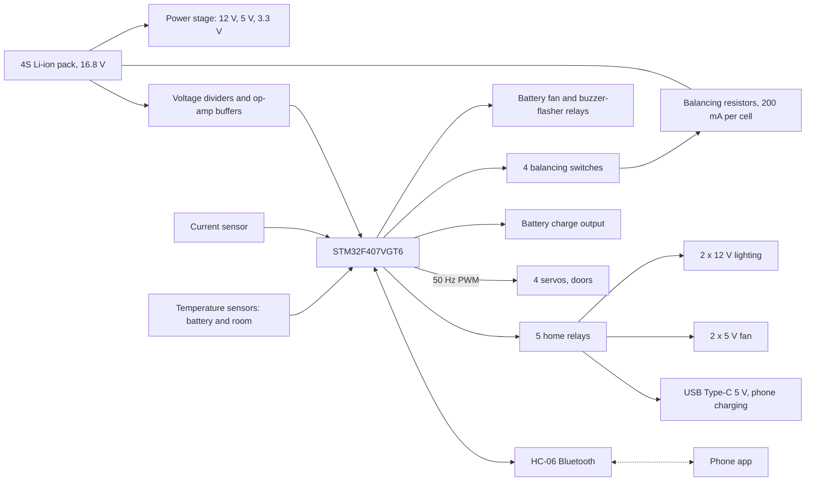
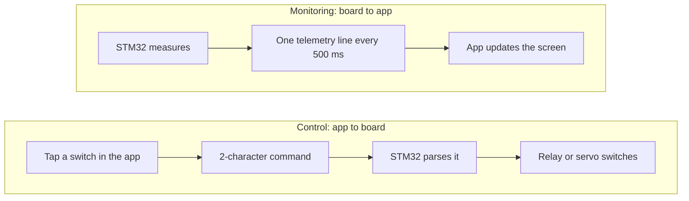
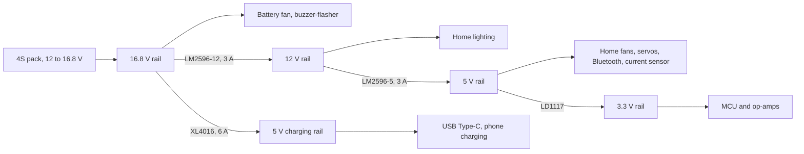
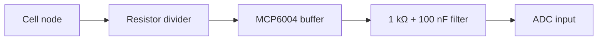
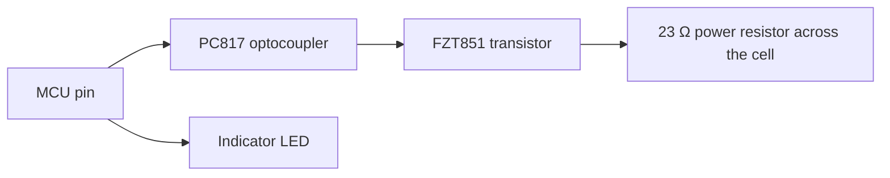
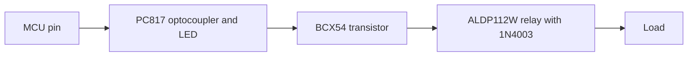

# 4S smart BMS and home automation controller

STM32F407 · 4S Li-ion · passive balancing · Bluetooth app · custom PCB

   [](https://tech-ohm.com)

**English** | [Türkçe](README.tr.md) · An open-source project by [TECH-OHM](https://tech-ohm.com)


A custom board and its firmware for a small battery-powered home system. It manages the battery and switches the loads. I designed both the hardware and the software.

On the battery side it measures cell voltages, current and temperature on a 4S Li-ion pack, balances the cells, and runs a fan and an alarm when the pack gets hot. On the home side it switches lighting, fans, a phone charging port and four door servos. Everything is monitored and controlled from a phone app over Bluetooth.

## Features

- Per-cell voltage measurement on a 4S pack, with pack voltage and state of charge
- Current, power, consumed energy (Wh) and remaining-time estimate
- Passive cell balancing, about 200 mA per cell
- Thermal protection: fan at 35 °C, buzzer and flasher at 55 °C
- Seven opto-isolated relay outputs and four servo channels
- A separate 5 V, 6 A rail for phone charging over USB Type-C
- Live telemetry and control from an Android app over Bluetooth

## System overview



## Phone app

The Android app is in [app/SmartBMSEnergy.apk](app/SmartBMSEnergy.apk). I built it with MIT App Inventor, and its interface is in Turkish. It has two screens: battery and home automation.

To try it, install the APK, pair the HC-06 module in the phone's Bluetooth settings, open the app, tap `BLUETOOTH CİHAZ ARA` and pick the module.

Two things happen over the Bluetooth link.



### Commands

A command is one letter followed by `1` (on) or `0` (off).

| Switch in the app | Command | On the board |
|---|---|---|
| Home LED 1 | `a1` / `a0` | 12 V lighting relay |
| Home LED 2 | `b1` / `b0` | 12 V lighting relay |
| Home fan 1 | `c1` / `c0` | 5 V fan relay |
| Home fan 2 | `d1` / `d0` | 5 V fan relay |
| Phone charging | `e1` / `e0` | USB Type-C 5 V relay |
| Battery charging | `f1` / `f0` | charge output |
| Door 1 to 4 | `g`, `h`, `i`, `j` + `1` / `0` | servo moves to open or closed |
| Reset consumption | `z` | energy counter is cleared |

### Telemetry

One comma-separated line every half second:

| # | Field | Example |
|---|---|---|
| 1 | State of charge, % | 89 |
| 2 | Pack voltage, V | 16.4 |
| 3 to 6 | Cell 1 to 4 voltage, V | 4.1 |
| 7, 8 | Battery and room temperature, °C | 28, 29 |
| 9 | Current, A | 0.01 |
| 10 | Power, W | 0.2 |
| 11 | Consumed energy, Wh | 0.1 |
| 12 | Remaining time, minutes (-1 if current is too low to estimate) | -1 |
| 13 to 16 | Balancing active on cell 1 to 4 | 0 |
| 17 | Temperature alarm | 0 |

```
89,16.4,4.1,4.1,4.1,4.1,28,29,0.01,0.2,0.1,-1,0,0,0,0,0
```

## Hardware

| Top | Bottom |
|---|---|
|  |  |


Full schematic: [docs/schematic.pdf](docs/schematic.pdf)

Bill of materials: [docs/bom.csv](docs/bom.csv), 63 lines and 207 parts.

| Sheet | Content | Preview |
|---|---|---|
| 1 | Power stage: input, 12 V, 5 V and 3.3 V regulators, phone charging rail | [open](docs/img/schematic-1-power.png) |
| 2 | Microcontroller, crystal, programming header, buttons | [open](docs/img/schematic-2-mcu.png) |
| 3 | Cell voltage sensing | [open](docs/img/schematic-3-cell-voltage.png) |
| 4 | Passive balancing | [open](docs/img/schematic-4-balancing.png) |
| 5 | Current sensing, temperature inputs, Bluetooth | [open](docs/img/schematic-5-current-temp-bluetooth.png) |
| 6 | Home control: lighting, fan and Type-C relays | [open](docs/img/schematic-6-home-control.png) |
| 7 | Battery fan and buzzer-flasher relays | [open](docs/img/schematic-7-fan-buzzer.png) |

The schematic sheets are labeled in Turkish.

### Power distribution



The phone charging port has its own 30 W converter, so a charging phone does not load the rail that feeds the MCU and the sensors.

### Cell voltage sensing

The cells are in series, so the upper nodes sit far above what the MCU can measure. Each node goes through its own divider down to about 3 V, then an MCP6004 op-amp buffer, then a 1 kΩ and 100 nF filter into the ADC. Without the buffer, the divider's high output impedance disturbs ADC sampling.



| Node | Max voltage | Divider | Ratio |
|---|---|---|---|
| 1 | 4.2 V | 4.02 kΩ / 10 kΩ | 1.40 |
| 2 | 8.4 V | 18 kΩ / 10 kΩ | 2.80 |
| 3 | 12.6 V | 32.4 kΩ / 10 kΩ | 4.24 |
| 4 | 16.8 V | 46.4 kΩ / 10 kΩ | 5.64 |

In the firmware, the third and fourth entries of `DIV_BAT` are 4.26 and 5.67. Those were measured with a multimeter and corrected for resistor tolerance. A small ratio error on the upper nodes turns into a large error in cell voltage, so this calibration is needed.

### Passive balancing

Switched-resistor method. Each cell has a power resistor across it and a transistor that connects it. The MCU output is isolated with an optocoupler because the switches of the upper cells work far above the MCU ground. Balancing current is about 200 mA.



### Relay outputs

All seven relays use the same circuit. The MCU pin drives an optocoupler and an indicator LED, the optocoupler drives a transistor, and the transistor pulls the relay coil. A diode across the coil absorbs the kickback when the relay releases.



### Other blocks

- **Current:** an ACS712-20A hall-effect sensor module plugs into a connector on the board. Its output is buffered and filtered before the ADC.
- **Temperature:** the board has four sensor inputs, each with a 1 kΩ and 100 nF filter. The firmware uses two: battery and room.
- **Bluetooth:** HC-06 module on 5 V, 9600 baud.
- **MCU:** STM32F407VGT6, 8 MHz crystal, ST-LINK header, reset and user buttons, two user LEDs.

### Differences between the schematic and the firmware

Sheet 1 is the current power stage. Sheets 2 to 7 come from an earlier export of the drawing. On those, the microcontroller sheet does not show the home outputs, servos, Bluetooth or the current input, and the temperature inputs are on different pins. Sheet 5 still shows a LEM CASR 25-NP current sensor. The board uses an ACS712-20A module, which is what the firmware is set up for.

The pin table below and the `.ioc` file are the current reference.

## Firmware

| File | Content |
|---|---|
| `adc_read.c` | ADC sampling, filtering, voltage, temperature, current, state of charge and energy |
| `balance.c` | passive cell balancing |
| `protection.c` | temperature-driven fan and alarm |
| `bluetooth.c` | telemetry and command handling |
| `main.c` | output tables, startup and main loop |

### Pins

| Pin | Function |
|---|---|
| PA2, PA3, PA4, PA5 | cell node voltages 1 to 4 |
| PA6, PA7 | temperature sensors: battery and room |
| PC0 | current sensor |
| PB9, PB8, PB7, PB6 | balancing outputs, cell 1 to 4 |
| PB0 | battery charge output |
| PD12, PD11 | home LED 1 and 2 |
| PD10, PD8 | home fan 1 and 2 |
| PD9 | USB Type-C 5 V |
| PD14 | battery fan |
| PD15 | buzzer-flasher |
| PD5, PD6 | user LEDs |
| PE9, PE11, PE13, PE14 | servo 1 to 4, TIM1 CH1 to CH4 |
| PA9, PA10 | USART1, HC-06 |

### Measurement

The ADC scans eight channels continuously with DMA: four cell nodes, two temperatures, current and the internal reference. Ten samples per channel are averaged.

**Supply correction.** The 3.3 V regulator output varies from board to board and with load. Instead of assuming 3.3 V, the firmware measures the internal reference (VREFINT) and compares it with the factory calibration value to find the real supply voltage. Every voltage is computed from that.

**Cell voltages.** A cell voltage is the difference between two neighboring nodes.

**Current.** The sensor's zero-current output is measured and stored at startup with no load. Current is computed against that and smoothed.

**State of charge.** The average cell voltage is looked up in a table that runs from 100% at 4.20 V to 0% at 3.00 V, with interpolation. This reads low under load, so treat it as a rough gauge.

**Remaining time.** Capacity (25 Ah) times state of charge, divided by the present current.

### Balancing

The four cell voltages are averaged. Any cell that sits more than `BALANCE_THRESHOLD` above the average gets its balancing output driven at 50% duty (1 second on, 1 second off). The resistor discharges that cell toward the others.

The threshold is left at 0.5 V for testing. For real use it should be around 0.03 to 0.05 V.

### Thermal protection

| State | On | Off | Output |
|---|---|---|---|
| Fan | 35 °C | 31 °C | battery fan |
| Alarm | 55 °C | 52 °C | buzzer-flasher, warning LEDs blink, alarm flag sent to the phone |

The gap between the on and off temperatures keeps the relay from chattering at the threshold.

### Servos

TIM1 generates 50 Hz PWM on four channels. A 1000 µs pulse is door closed, 1500 µs is door open.

## Limitations

This firmware monitors, balances and protects against heat, but it does not replace a full protection circuit:

- No cell over-charge or over-discharge cutoff.
- No over-current or short-circuit protection.
- The charge output is switched only by a command from the phone.

When you work with a Li-ion pack, keep an independent hardware protection circuit on the pack.

## Build

In STM32CubeIDE use `File > Import > Existing Projects into Workspace` and select this folder. The clock is 168 MHz from the external crystal.

## License

The firmware is MIT licensed. The STM32 HAL and CMSIS files under `Drivers` keep their own licenses. The schematic and board images under `docs` are provided for reference.

## Author

M. Eyüb Can, embedded systems engineer and founder of [TECH-OHM](https://tech-ohm.com)

## About TECH-OHM

[TECH-OHM](https://tech-ohm.com) designs electronic boards and embedded software, from the first schematic to series production. We also run a 12-month embedded systems training program and consult for engineering teams.

Web: [tech-ohm.com](https://tech-ohm.com) · Email: info@tech-ohm.com
