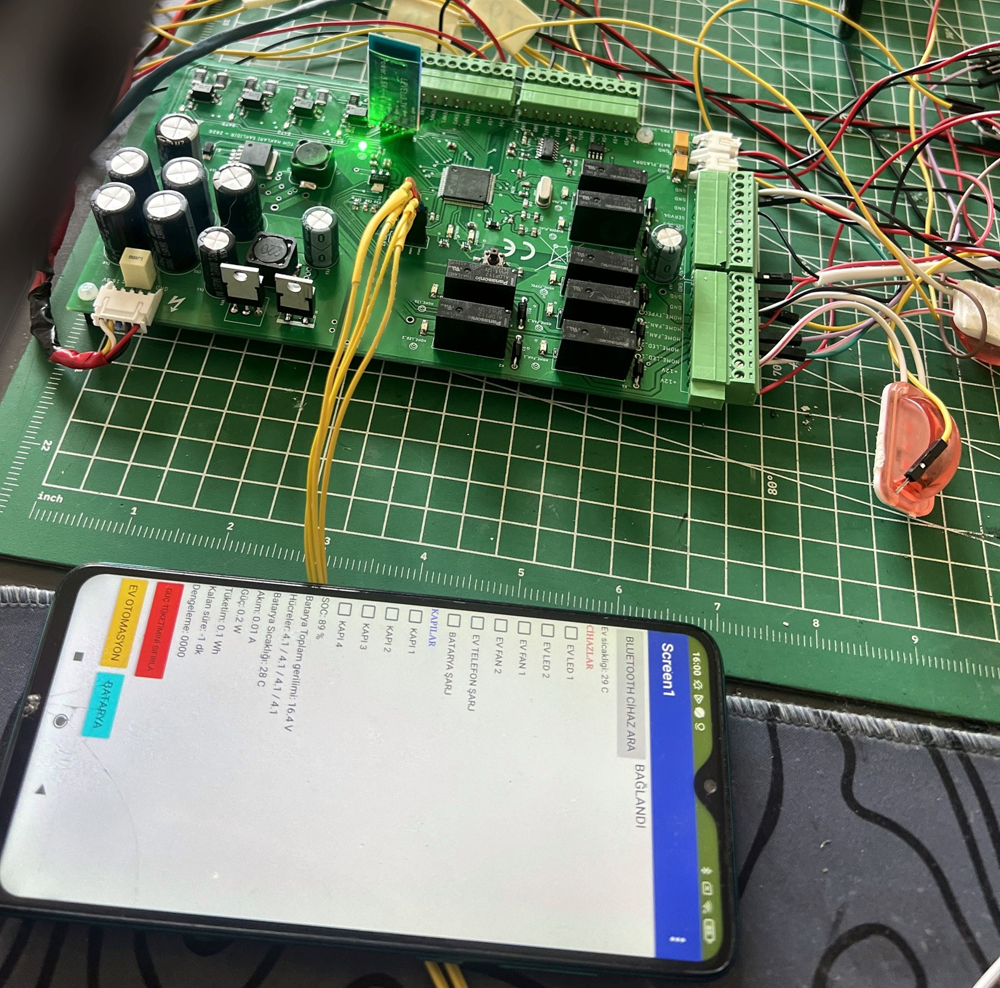
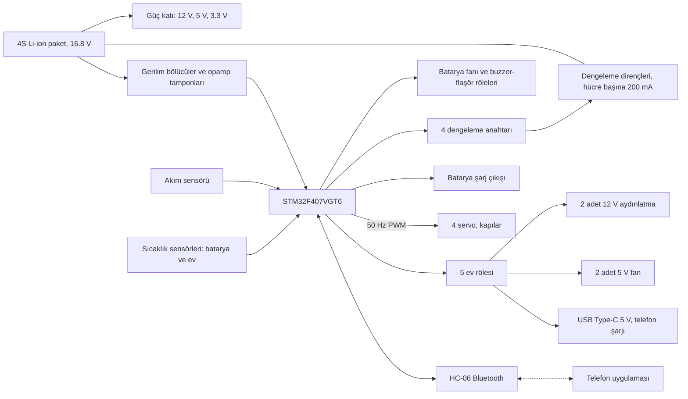
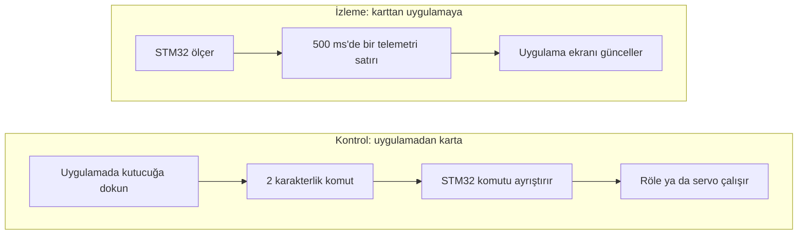
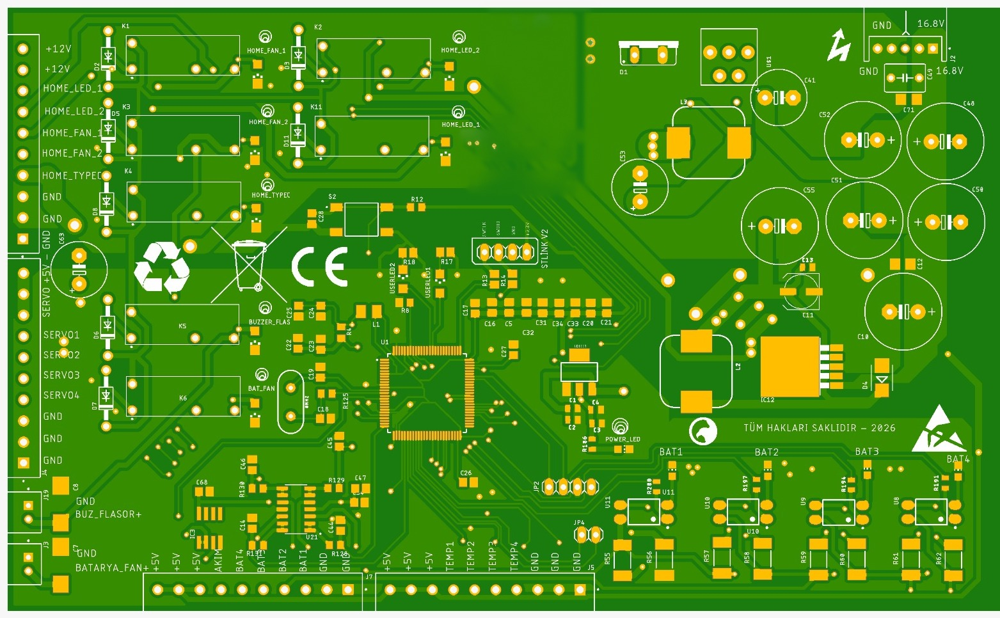
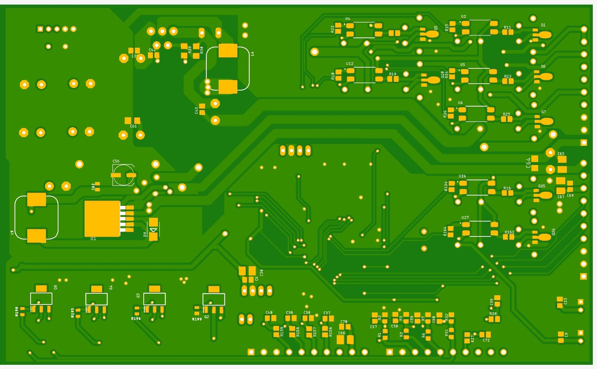
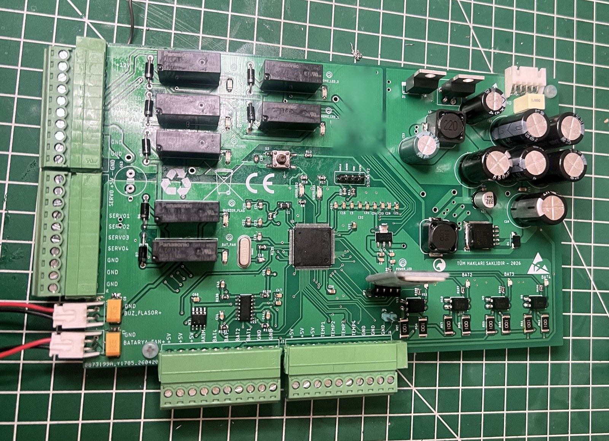
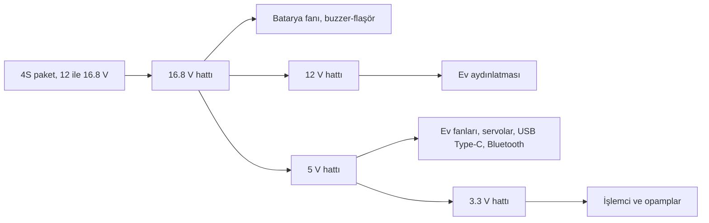
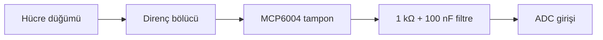
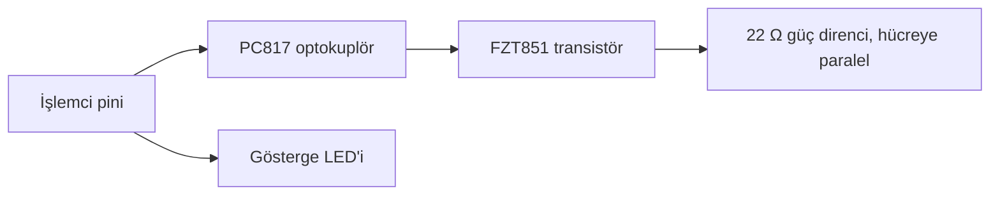

# 4S akıllı BMS ve ev otomasyon kartı

STM32F407 · 4S Li-ion · pasif dengeleme · Bluetooth uygulaması · özel tasarım kart

[English](README.md) | **Türkçe**

> [TECH-OHM](https://tech-ohm.com) açık kaynak projesi



Bataryadan beslenen küçük bir ev sisteminin hem bataryasını hem de çıkışlarını yöneten kart ve yazılımı. Kartı da yazılımı da ben tasarladım.

Batarya tarafında 4 seri Li-ion paketin hücre gerilimlerini, akımını ve sıcaklığını ölçüyor, hücreleri dengeliyor, ısınınca fanı ve alarmı çalıştırıyor. Ev tarafında aydınlatmayı, fanları, telefon şarj çıkışını ve dört kapı servosunu sürüyor. Hepsi Bluetooth üzerinden bir telefon uygulamasıyla izlenip kontrol ediliyor.

## Sistem



## Telefon uygulaması

Uygulamanın iki ekranı var: batarya ve ev otomasyonu. Bluetooth hattında iki şey oluyor.



**Uygulamadan kontrol edilenler**

| Uygulamadaki kutucuk | Komut | Kartta olan |
|---|---|---|
| Ev LED 1 | `a1` / `a0` | 12 V aydınlatma rölesi |
| Ev LED 2 | `b1` / `b0` | 12 V aydınlatma rölesi |
| Ev fan 1 | `c1` / `c0` | 5 V fan rölesi |
| Ev fan 2 | `d1` / `d0` | 5 V fan rölesi |
| Ev telefon şarj | `e1` / `e0` | USB Type-C 5 V rölesi |
| Batarya şarj | `f1` / `f0` | şarj çıkışı |
| Kapı 1 ile 4 | `g`, `h`, `i`, `j` + `1` / `0` | servo açık ya da kapalı konuma döner |
| Güç tüketimini sıfırla | `z` | enerji sayacı sıfırlanır |

**Uygulamada gösterilenler**

Şarj yüzdesi, paket gerilimi, dört hücrenin gerilimi, batarya sıcaklığı, ev sıcaklığı, akım, anlık güç, toplam tüketim (Wh), tahmini kalan süre, hangi hücrenin dengelendiği ve sıcaklık alarmı.

Telemetri virgülle ayrılmış tek satır olarak gidiyor:

```
şarj%, paket V, hücre1, hücre2, hücre3, hücre4, sıcaklık1, sıcaklık2, akım A, güç W, enerji Wh, kalan dakika, denge1, denge2, denge3, denge4, alarm
```

```
89,16.4,4.1,4.1,4.1,4.1,28,29,0.01,0.2,0.1,-1,0,0,0,0,0
```

Kalan dakika -1 ise akım çok düşük, süre hesaplanamıyor demek.

## Donanım

| Üst yüz | Alt yüz |
|---|---|
|  |  |



Şemanın tamamı: [docs/schematic.pdf](docs/schematic.pdf)

| Sayfa | İçerik | Önizleme |
|---|---|---|
| 2 | Mikrodenetleyici, kristal, programlama başlığı, butonlar | [aç](docs/img/schematic-2-mcu.png) |
| 3 | Hücre gerilimi okuma | [aç](docs/img/schematic-3-cell-voltage.png) |
| 4 | Pasif dengeleme | [aç](docs/img/schematic-4-balancing.png) |
| 5 | Akım okuma, sıcaklık girişleri, Bluetooth | [aç](docs/img/schematic-5-current-temp-bluetooth.png) |
| 6 | Ev kontrolü: aydınlatma, fan ve Type-C röleleri | [aç](docs/img/schematic-6-home-control.png) |
| 7 | Batarya fanı ve buzzer-flaşör röleleri | [aç](docs/img/schematic-7-fan-buzzer.png) |

### Güç dağıtımı



### Hücre gerilimi okuma

Dört hücre seri olduğu için üst hücrelerin toprağa göre gerilimi işlemcinin ölçebileceğinden çok yüksek. Her düğüm ayrı bir bölücüyle 3 V civarına indiriliyor, ardından MCP6004 opamp ile tamponlanıp 1 kΩ ve 100 nF'lık filtreden geçerek ADC'ye gidiyor. Tampon olmadan bölücünün yüksek çıkış direnci ADC örneklemesini bozar.



| Düğüm | En yüksek gerilim | Bölücü | Oran |
|---|---|---|---|
| 1 | 4.2 V | 4.02 kΩ / 10 kΩ | 1.40 |
| 2 | 8.4 V | 18 kΩ / 10 kΩ | 2.80 |
| 3 | 12.6 V | 32.4 kΩ / 10 kΩ | 4.24 |
| 4 | 16.8 V | 46.4 kΩ / 10 kΩ | 5.64 |

Yazılımdaki `DIV_BAT` dizisinde üçüncü ve dördüncü oran 4.26 ve 5.67. Bunlar direnç toleransı yüzünden multimetreyle ölçülüp düzeltilmiş değerler. Üst düğümlerde küçük bir oran hatası hücre geriliminde büyük hata yaptığı için bu kalibrasyon şart.

### Pasif dengeleme

Anahtarlamalı direnç yöntemi. Her hücrenin üzerinde bir güç direnci ve onu devreye alan bir transistör var. İşlemci çıkışı optokuplörle yalıtılmış, çünkü üst hücrelerin anahtarı işlemcinin toprağına göre yüksek gerilimde çalışıyor. Dengeleme akımı yaklaşık 200 mA.



### Röle çıkışları

Yedi röle de aynı devreyle sürülüyor. İşlemci pini optokuplörü ve gösterge LED'ini sürüyor, optokuplör transistörü, transistör röle bobinini çekiyor. Bobine paralel diyot, röle bırakırken oluşan gerilimi söndürüyor.


### Diğerleri

- **Akım:** hall etkili sensörün çıkışı tamponlanıp filtreden geçerek ADC'ye gidiyor.
- **Sıcaklık:** kartta dört sensör girişi var, her birinde 1 kΩ ve 100 nF filtre. Yazılım ikisini kullanıyor: batarya ve ev.
- **Bluetooth:** HC-06 modülü 5 V'tan besleniyor, 9600 baud.
- **İşlemci:** STM32F407VGT6, 8 MHz kristal, ST-LINK başlığı, reset ve kullanıcı butonu, iki kullanıcı LED'i.

### Şema ile yazılım arasındaki farklar

Depodaki şema kartın ilk çizimi. Güç katının olduğu birinci sayfa eksik. Mikrodenetleyici sayfasında ev çıkışları, servolar, Bluetooth ve akım girişi görünmüyor, sıcaklık girişleri de farklı pinlerde. Akım sensörü şemada LEM CASR 25-NP olarak çizili, yazılım ise 100 mV/A veren bir sensöre (ACS712-20A) göre ayarlı.

Güncel pin atamaları aşağıdaki tabloda ve `.ioc` dosyasında.

## Yazılım

| Dosya | İçerik |
|---|---|
| `adc_read.c` | ADC okuma, filtre, gerilim, sıcaklık, akım, şarj yüzdesi ve enerji hesabı |
| `balance.c` | pasif hücre dengeleme |
| `protection.c` | sıcaklığa bağlı fan ve alarm |
| `bluetooth.c` | telemetri gönderme ve komut alma |
| `main.c` | çıkış tabloları, başlatma ve ana döngü |

### Pinler

| Pin | Görev |
|---|---|
| PA2, PA3, PA4, PA5 | hücre düğüm gerilimleri 1 ile 4 |
| PA6, PA7 | sıcaklık sensörleri: batarya ve ev |
| PC0 | akım sensörü |
| PB9, PB8, PB7, PB6 | dengeleme çıkışları, hücre 1 ile 4 |
| PB0 | batarya şarj çıkışı |
| PD12, PD11 | ev LED 1 ve 2 |
| PD10, PD8 | ev fan 1 ve 2 |
| PD9 | USB Type-C 5 V |
| PD14 | batarya fanı |
| PD15 | buzzer-flaşör |
| PD5, PD6 | kullanıcı LED'leri |
| PE9, PE11, PE13, PE14 | servo 1 ile 4, TIM1 CH1 ile CH4 |
| PA9, PA10 | USART1, HC-06 |

### Ölçüm

ADC sekiz kanalı DMA ile sürekli tarıyor: dört hücre düğümü, iki sıcaklık, akım ve işlemcinin dahili referansı. Her kanal için 10 örnek toplanıp ortalaması alınıyor.

**Besleme gerilimi düzeltmesi.** 3.3 V regülatörün çıkışı karttan karta ve yüke göre değişir. Hesapta sabit 3.3 kullanmak yerine dahili referans (VREFINT) ölçülüyor ve fabrika kalibrasyon değeriyle karşılaştırılarak gerçek besleme gerilimi bulunuyor. Bütün gerilimler buna göre hesaplanıyor.

**Hücre gerilimleri.** Hücre gerilimi komşu düğümlerin farkından bulunuyor.

**Akım.** Sensörün sıfır akımdaki çıkışı açılışta, yük yokken ölçülüp kaydediliyor. Akım buna göre hesaplanıp yumuşatılıyor.

**Şarj yüzdesi.** Ortalama hücre gerilimi, 4.20 V için %100 ve 3.00 V için %0 olan bir tablodan ara değer hesabıyla okunuyor. Bu yöntem batarya yük altındayken düşük gösterir, kaba bir göstergedir.

**Kalan süre.** Kapasite (25 Ah) ile şarj yüzdesinin çarpımı, o an çekilen akıma bölünüyor.

### Dengeleme

Dört hücrenin ortalaması alınıyor. Ortalamadan `BALANCE_THRESHOLD` kadar yüksek olan hücrenin dengeleme çıkışı %50 oranla (1 saniye açık, 1 saniye kapalı) sürülüyor. Dengeleme direnci o hücreyi boşaltarak diğerlerine yaklaştırıyor.

Eşik denemeler için 0.5 V bırakıldı. Gerçek kullanımda 0.03 ile 0.05 V arasına çekilmeli.

### Sıcaklık koruması

| Durum | Açılma | Kapanma | Çıkış |
|---|---|---|---|
| Fan | 35 C | 31 C | batarya fanı |
| Alarm | 55 C | 52 C | buzzer-flaşör, uyarı LED'leri yanıp söner, telefona uyarı bayrağı |

Açılma ve kapanma sıcaklıkları arasındaki fark rölenin eşikte titremesini önlüyor.

### Servolar

TIM1 dört kanaldan 50 Hz PWM üretiyor. Darbe 1000 µs iken kapı kapalı, 1500 µs iken açık.

## Eksikler

Bu yazılım izleme, dengeleme ve sıcaklık korumasını yapıyor ama tam bir koruma devresinin yerini tutmaz:

- Hücre aşırı şarj ve aşırı deşarj kesmesi yok.
- Aşırı akım ve kısa devre koruması yok.
- Şarj çıkışı sadece telefondan gelen komutla açılıp kapanıyor.

Li-ion paketle çalışırken pakette bağımsız bir donanım koruma devresi mutlaka bulunsun.

## Derleme

STM32CubeIDE'de `File > Import > Existing Projects into Workspace` ile klasörü seç. Saat harici kristalden 168 MHz.

## Lisans

Yazılım MIT lisanslı. `Drivers` klasöründeki STM32 HAL ve CMSIS dosyaları kendi lisanslarıyla gelir. `docs` klasöründeki şema ve kart görselleri bilgi amaçlıdır.

## Yazar

Gömülü Sistem Mühendisi M. Eyüb Can, [TECH-OHM](https://tech-ohm.com) kurucusu

## TECH-OHM

[TECH-OHM](https://tech-ohm.com) elektronik kart ve gömülü yazılım tasarlayan bir mühendislik firması. Fikirden seri üretime kadar tasarım işi alıyor, TECH-OHM Akademi'de 12 aylık gömülü sistem eğitimi ve şirketlere özel danışmanlık veriyor.

Web: [tech-ohm.com](https://tech-ohm.com) · E-posta: info@tech-ohm.com
